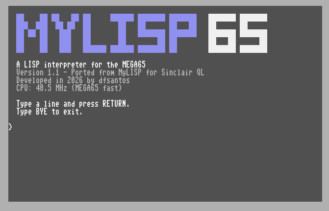
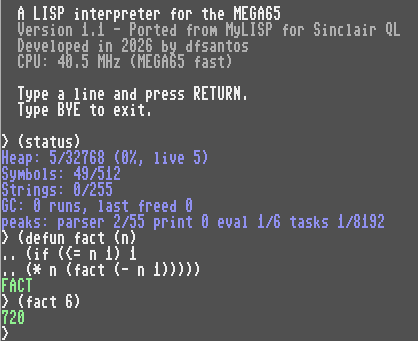
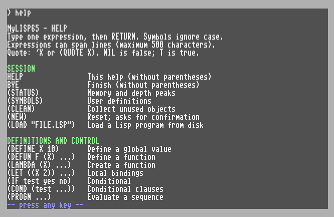

# MyLISP65

A LISP-1 interpreter for the **Commodore MEGA65**.

MyLISP65 is a port of [MyLISP](https://github.com/dfernande132/MyLISP), which was written in
Pascal for the Sinclair QL and later ported to C for the ZX Spectrum Next. This is that C code
brought to the MEGA65 — **the same language**, not a variant.

It is built as an engine for computer algebra: it favours mathematical exactness over
convenience, strict lexical scope, and type safety over silent coercion.

**The CAS written for MyLISP runs on MyLISP65 without a single change.** `CAS.LSP` in
`EXAMPLES/` is the same file, byte for byte, that runs on the QL and the Next — see
[MyLISP-CAS](https://github.com/dfernande132/MyLISP-CAS).



---

## Quick start

Mount `MYLISP65.D81` in drive 8 and:

```
LOAD"MYLISP65",8
RUN
```

At the `>` prompt, load any example with the interpreter's own `LOAD` — not BASIC's:

```lisp
(LOAD "SORT.LSP")
(LOAD "CAS.LSP")
(LOAD "PCAS.LSP")     ; needs CAS.LSP loaded first
```

Every expression in the file is evaluated and its result printed. `HELP` shows the built-in
reference, `(STATUS)` reports heap, symbol and string usage, and `BYE` exits. `HELP` and `BYE`
are typed without parentheses — they are commands, not LISP forms.

A session, from a definition typed across three lines to the memory report:



Note the `..` continuation prompt: an expression can span as many lines as it needs, and is
only parsed once the parentheses balance.

`HELP` prints the reference from `HELP.INI`, a page at a time:



---

## What's in this repository

```
MYLISP65.PRG    the interpreter, ready to run
MYLISP65.D81    disk image with the interpreter, the data files and every example
BANNER.INI      the start-up logo, as editable text
HELP.INI        the text shown by the HELP command
EXAMPLES/       the example programs, as plain .LSP text
DOCS/           technical reference
SCREENSHOT/     screenshots used in this page
```

The `.LSP` files in `EXAMPLES/` are byte for byte the same as the ones inside the disk image.

### If you use MYLISP65.PRG on your own disk

Since 1.1 the logo and the help text live **on the disk**, not inside the binary. Copy
`BANNER.INI` and `HELP.INI` next to `MYLISP65.PRG` and everything works as on the supplied
image. Without them the interpreter still runs normally — it just prints its name as plain
text instead of the logo, and `HELP` reports the missing file.

Both are ordinary text and you are meant to edit them. Two rules: keep the line endings as
they are (**CR**, the Commodore convention — a Windows editor that saves CRLF will double
every line), and keep the marker in column 0. A line starting with `#` is block art, where
each `#` becomes a solid cell and `~` switches to the accent colour; `*` makes the whole line
a section heading; `=` makes it a title. The marker itself is never printed.

---

## Included examples

| file | what it does |
|---|---|
| `CAS.LSP` | a computer algebra system written in LISP — the reason the interpreter exists ([its own repository](https://github.com/dfernande132/MyLISP-CAS)) |
| `PCAS.LSP` | exercises the CAS chapter by chapter. Load `CAS.LSP` first |
| `DERIVA.LSP` | symbolic differentiation |
| `SORT.LSP` | selection sort over lists |
| `ORDEN.LSP` | higher-order functions: MAP, FILTER, folds |
| `BASIC.LSP` | a tour of the basic primitives |
| `TICTACTOE.LSP` | interactive tic-tac-toe; the machine plays a real strategy |

---

## How it works

The MEGA65 gives a C program a 32K window for code. Everything else lives in the 8 MB of
**Attic RAM**, reached through Calypsi's 32-bit `__huge` pointers.

- **A 32,768-cell heap in Attic RAM.** The whole interpreter state — heap, symbol table,
  string table, task stack, GC stacks — takes 0.52 MB of the 8 MB, and not one byte of the
  32K window.
- **An iterative evaluator.** A LISP program's recursion depth lives in an explicit task
  stack in Attic RAM, not on the 6502 hardware stack — which is 256 bytes and runs out at 84
  frames. Deep recursion is limited by the heap, not by the CPU.
- **Mark-sweep garbage collection** with iterative marking, running silently between
  expressions.
- **Exact rational arithmetic.** `(/ 1 3)` is `1/3`, not `0`. Results are always reduced, and
  collapse back to an integer when the denominator is 1. Arithmetic overflow is detected and
  reported rather than wrapping silently.
- **Files are read from a D81 through the KERNAL**, so `(LOAD "CAS.LSP")` works from the
  interpreter itself.

- **The start-up screen reports the CPU speed**, read from the hardware rather than assumed.
  On a stock MEGA65 it says 40.5 MHz: the KERNAL enables fast mode before any user code runs.

Limits: 32,768 cells, 512 symbols of 15 significant characters, 255 strings of 63, and 500
characters per expression. Nested `EVAL` is limited to 6 levels and nested parentheses to 55 —
both are hard limits of the 6502's stacks, measured on the machine, and both report an error
instead of failing. `DOCS/` has the details.

Built with the [Calypsi](https://www.calypsi.cc/) C compiler (`cc6502` / `ln6502`) for the
45GS02 — not cc65.

---

## Documentation

[`DOCS/TECHNICAL_REFERENCE.md`](DOCS/TECHNICAL_REFERENCE.md) — the full technical reference:
memory model, data types, the numeric system, special forms, the garbage collector, `LOAD`,
depth limits and diagnostics, and a complete primitive reference.

Everything in it was checked against the source or measured by running it — including the
parts that turned out to contradict the older documentation.

---

## Changelog

**v1.1** — appearance and stability.

- A new colour scheme, shared in spirit with the QL and ZX Spectrum Next versions of MyLISP:
  the sixteen stock MEGA65 inks mapped to the roles of the original palette, every one of them
  measured for contrast against the background actually used.
- `HELP`, a new command. The help text and the start-up logo now live on the disk as editable
  text files, so they cost nothing in the interpreter's 32K code window and you can change
  them without recompiling.
- The start-up screen reports the CPU speed, read from the hardware.
- **Fixed a crash present in 1.0.** Seven or more levels of nested `EVAL` overflowed the C
  stack, which on this memory map sits directly above the program's own code: the overflow
  rewrote the running program and dropped the machine into the monitor, with no error message.
  The nesting limit is now set from a measurement (each level costs 713 bytes of a 4 KB stack)
  and the interpreter reports the error instead. Nothing a normal program does came close —
  the deepest real use measured is 3 levels — but it was reachable by hand.

**v1.0** — first release for the MEGA65. Complete interpreter: iterative evaluator, GC, exact
rational arithmetic, and `LOAD` from disk. Passes a 90-test regression battery that runs on
the machine itself.

---

## Related

- [MyLISP](https://github.com/dfernande132/MyLISP) — the original, for the Sinclair QL.
- [MyLISP-CAS](https://github.com/dfernande132/MyLISP-CAS) — the computer algebra system,
  which runs unchanged on both.

---

## Licence

Free to use, privately or commercially. **Programs you write in MyLISP65 are entirely
yours** — no royalties, no permission needed — and you may ship the interpreter alongside
them. The interpreter is distributed in binary form only; the source is not released.

See [LICENSE.txt](LICENSE.txt) for the full terms.

Bug reports and comments are welcome.
